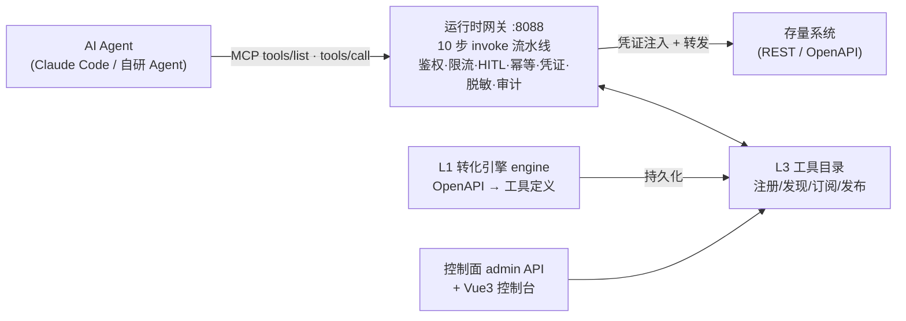

# AllCLI · 存量系统 → AI 工具化平台

> **让每一个存量系统，都能被 AI 安全、智能地调用。**
> 扔进一份 OpenAPI/Swagger 文件，存量 REST 接口一键变成带语义描述、Schema、副作用声明的「AI 工具」，经 MCP 网关暴露给 Agent —— 存量系统零改造，AI 治理零旁路。

[](#) [](#) [](#) [](#) [](#) [](#) [](LICENSE)

## ✨ 项目亮点

* ⚡ **存量零改造**：不需要改动老系统一行代码，上传 OpenAPI/Swagger 文件即可生成工具定义 —— 语义描述、JSON Schema、示例、副作用（只读/破坏性/可逆/幂等）与 HITL 审批要求全部自动推断。
* 🛡️ **治理零旁路**：所有调用走 10 步 invoke 流水线（鉴权 → 校验 → 限流 → 分级 → HITL 人审 → 幂等 → 凭证加密注入 → 脱敏 → 调用 → 审计），MCP `tools/call` 与管理面同一条链路，无后门。
* 🔌 **MCP 原生**：内置 MCP Server（Streamable HTTP `/mcp`），Claude Code 等任意 MCP 客户端一行命令接入；工具自带 `readOnlyHint` / `destructiveHint` 注解与 `_meta` 治理字段。
* 🧪 **上线自检**：沙箱试运行生成确定性 mock 响应（不触达真实系统）+ 质量自检 checklist，坏工具上不了线。
* 🖥️ **全套控制台**：Vue 3 管理台 —— 指标看板 / 工具目录 / OpenAPI 导入向导 / 在线调用测试 / HITL 审批中心 / 订阅治理 / 审计导出 / 系统与凭证注册。
* 🚀 **一键断流**：订阅吊销（revoke）即 Kill Switch，invoke 立即被拒，AI 失控风险秒级止损。

## 📘 项目概述

**AllCLI** 是一个「存量系统 → AI 工具化」平台：**L1 转化引擎**把存量 REST 接口（OpenAPI/Swagger 描述）转化为标准工具定义并持久化；**L4 运行时网关**以 MCP / Function Calling 协议把工具暴露给各类 Agent，工具目录（注册 / 发现 / 订阅 / 发布）与全部安全治理策略内置其间。后端为 Java / Spring Boot 多模块工程，前端为独立 Vue 3 工程。



## 🌟 核心功能

* **一键转化**：OpenAPI/Swagger → 工具定义（语义 / Schema / 示例 / 副作用 / HITL 自动推断），CLI `--persist` 与异步导入 API 两种入口
* **工具目录**：注册、脱敏检索、订阅 + 审批、发布（写版本快照，MCP `tools/list` 热更新免重启）
* **运行时治理**：10 步流水线 —— Agent 鉴权、JSON Schema 校验、限流、风险分级、HITL 人审、幂等去重、凭证 SM4 信封加密、响应脱敏、全量调用审计
* **HITL 人机协同**：写操作挂起返回 `pending_approval`（正常 tool result 而非错误），审批通过后放行
* **沙箱试运行 + 质量自检**：确定性 mock 可做回归对比；writeGuard 等上线前检查（reversibility 未标注直接 fail）
* **控制面 admin API**：系统 / 凭证注册（密钥不回显）、导入 job、语义编辑（published 描述热生效）、审计查询 + CSV 导出、指标看板、订阅治理
* **可观测**：Prometheus 端点（QPS / 延迟 / JVM）+ 调用审计留痕
* **前端控制台约 9 页**：登录 / 看板 / 目录 / 工具详情 / 导入向导 / 调用 Playground（内联审批）/ 订阅治理 / HITL 审批中心 / 审计 / 系统凭证

## 🛠️ 技术栈

* **后端**：Java 17 · Spring Boot 3.5 · Spring AI 1.1（MCP java-sdk，Streamable HTTP 传输）
* **存储**：MySQL 8.0（元数据七表，`sql/V1__init.sql`）· Redis 7
* **前端**：Vue 3 + TypeScript + Vite + Element Plus + Pinia
* **可观测**：Spring Boot Actuator + Prometheus
* **测试**：JUnit 5 —— engine 29 + gateway 81，共 **110 个后端测试全绿**；另有 Playwright UI 冒烟脚本

## 📁 项目结构

```text
AllCLI/
├── engine/       # L1 转化引擎：OpenAPI → 工具定义（可执行 jar CLI）
├── gateway/      # L4 运行时网关：invoke 流水线 + L3 目录 + MCP Server + admin API（同进程）
├── frontend/     # 管理控制台（Vue 3 + TS + Element Plus，独立 npm 工程）
├── examples/     # Agent 接入示例（Python / Node，零依赖）
├── sql/          # 元数据库 DDL（七表）
├── testdata/     # petstore.yaml（转化引擎对标输入）
├── scripts/      # E2E 辅助（MockPetstore 下游替身 / UI 冒烟）
└── AllCLI_*.md   # 规划文档：需求说明书 / PRD / 架构选型 / WBS 排期 / 使用手册…
```

## 🚀 本地运行

1. **克隆仓库**

   ```shell
   git clone https://gitee.com/Zephyr2026/AllCLI.git
   cd AllCLI
   ```

2. **准备环境**：JDK 17+ · Maven 3.6+ · Node ≥ 20（仅前端）· MySQL 8 + Redis 7（Docker 即可）

   ```shell
   docker run -d --name allcli-mysql -e MYSQL_ROOT_PASSWORD=allcli -e MYSQL_DATABASE=allcli -p 3306:3306 mysql:8.0
   docker run -d --name allcli-redis -p 6379:6379 redis:7
   docker exec -i allcli-mysql mysql -uroot -pallcli allcli < sql/V1__init.sql
   ```

   再按需修改 `gateway/src/main/resources/application.yml` 中的 MySQL / Redis 地址，以及 `allcli.admin.tokens`（管理面 token）。

3. **构建与全量测试**（110 个测试）

   ```shell
   mvn test
   ```

4. **启动网关**（端口 8088，含 MCP Server 与 admin API）

   ```shell
   mvn -pl gateway -am spring-boot:run
   ```

5. **启动前端控制台**（http://localhost:5173）

   ```shell
   cd frontend
   npm install
   npm run dev
   ```

6. **登录**：登录页填入 admin token（开发默认 `admin_m4-dev-admin`，即 `admin_` + 配置值）与默认 Agent ID（演示用 `agent_demo`）。

## 🔌 接入你的 Agent

任何 MCP 客户端均可接入。以 Claude Code 为例：

```shell
claude mcp add --transport http allcli http://localhost:8088/mcp \
  --header "Authorization: Bearer agent_demo"
```

会话内即可看到已发布工具（如 `listPets` / `createPet`，含只读 / 破坏性注解），`tools/call` 全部经网关流水线治理。零依赖的 Python / Node 接入示例见 `examples/`（目录检索 → 质量自检 → 沙箱 → 真实调用四步）。

## 🔧 部署建议

* 网关为单体 Spring Boot 应用：`mvn package` 后 `java -jar gateway/target/*.jar` 单进程部署，外置 MySQL / Redis
* MCP 端点 `/mcp` 与 REST `/api/v1/**` 均需带 token（Agent 侧 `agent_<id>`，管理面 `admin_<secret>`），建议置于反向代理 / 内网之后
* Actuator 仅暴露 `health,prometheus`，Prometheus 从 `/actuator/prometheus` 抓取

## 📌 注意事项

* 一期 Agent / admin token 为演示形态（无签名、明文配置、单角色无 RBAC），生产环境需替换为 OAuth2 / API Key 体系
* 导入 job 与 MCP 目录热更新为单节点内存态，多实例部署需引入持久化或广播机制
* HITL 审批结果不主动回推 MCP 会话，Agent 依据 `pending_approval` 返回的 approvalId 轮询或转述
* 业务错误统一以 HTTP 200 + 错误码信封返回（`code != "OK"` 即失败），集成时请按信封字段分支处理

## 🏆 致谢

* 感谢 **[Model Context Protocol](https://modelcontextprotocol.io/)** 与 **Spring AI** 团队提供的开放协议与实现。
* 感谢 **Vue**、**Element Plus** 带来的高效前端开发体验。
* 感谢 **MySQL**、**Redis** 等开源软件构建的坚实生态。
## 🤝 赞助


## 📝 许可证

[木兰公共许可证（第 2 版）MulanPSL-2.0](LICENSE) © 2026 AllCLI 贡献者
