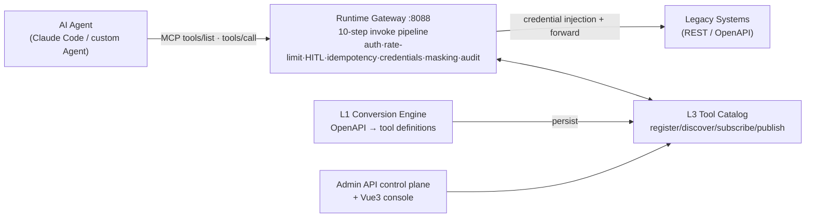

# AllCLI · Legacy Systems → AI Tooling Platform

English | **[简体中文](README.zh-CN.md)**

> **Let every legacy system be invoked by AI — safely and intelligently.**
> Drop in an OpenAPI/Swagger file and existing REST endpoints become "AI tools" in one click — complete with semantic descriptions, schemas, and side-effect declarations — exposed to Agents through an MCP gateway. Zero changes to legacy systems, zero bypasses around AI governance.

[](#) [](#) [](#) [](#) [](#) [](#) [](LICENSE)

## ✨ Highlights

* ⚡ **Zero legacy refactoring**: Not a single line of the old system needs to change — upload an OpenAPI/Swagger file and tool definitions are generated with semantic descriptions, JSON Schema, examples, side effects (read-only / destructive / reversible / idempotent), and HITL approval requirements all inferred automatically.
* 🛡️ **Zero governance bypass**: Every call goes through a 10-step invoke pipeline (auth → validation → rate limiting → risk classification → HITL review → idempotency → encrypted credential injection → data masking → invocation → audit). MCP `tools/call` and the admin plane share the exact same chain — no backdoors.
* 🔌 **MCP native**: Built-in MCP Server (Streamable HTTP `/mcp`); any MCP client such as Claude Code connects with a single command; tools carry `readOnlyHint` / `destructiveHint` annotations and `_meta` governance fields.
* 🧪 **Pre-launch self-check**: Sandbox dry-runs produce deterministic mock responses (real systems are never touched) plus a quality checklist — bad tools simply can't go live.
* 🖥️ **Full console**: Vue 3 admin console — metrics dashboard / tool catalog / OpenAPI import wizard / online invoke testing / HITL approval center / subscription governance / audit export / system & credential registration.
* 🚀 **One-click kill switch**: Revoking a subscription is a kill switch — invokes are rejected immediately, containing runaway-AI risk within seconds.

## 📘 Overview

**AllCLI** is a "legacy systems → AI tooling" platform: the **L1 conversion engine** turns existing REST endpoints (described by OpenAPI/Swagger) into standard tool definitions and persists them; the **L4 runtime gateway** exposes those tools to any Agent via MCP / Function Calling protocols, with the tool catalog (register / discover / subscribe / publish) and all security governance policies built in. The backend is a Java / Spring Boot multi-module project; the frontend is a standalone Vue 3 project.



## 🌟 Core Features

* **One-click conversion**: OpenAPI/Swagger → tool definitions (semantics / schema / examples / side effects / HITL auto-inferred), via two entry points — the CLI with `--persist` and an async import API
* **Tool catalog**: registration, masked search, subscription + approval, publishing (writes version snapshots; MCP `tools/list` hot-reloads without restart)
* **Runtime governance**: 10-step pipeline — agent authentication, JSON Schema validation, rate limiting, risk classification, HITL review, idempotent deduplication, SM4 envelope-encrypted credentials, response masking, full invoke auditing
* **HITL human-in-the-loop**: write operations are suspended and return `pending_approval` (a normal tool result, not an error), then released once approved
* **Sandbox dry-run + quality self-check**: deterministic mocks enable regression comparison; pre-launch checks such as writeGuard (an unlabeled reversibility fails outright)
* **Admin control-plane API**: system / credential registration (secrets never echoed back), import jobs, semantic editing (published descriptions take effect live), audit query + CSV export, metrics dashboard, subscription governance
* **Observable**: Prometheus endpoints (QPS / latency / JVM) plus a full invoke audit trail
* **~9 frontend pages**: login / dashboard / catalog / tool detail / import wizard / invoke playground (inline approval) / subscription governance / HITL approval center / audit / systems & credentials

## 🛠️ Tech Stack

* **Backend**: Java 17 · Spring Boot 3.5 · Spring AI 1.1 (MCP java-sdk, Streamable HTTP transport)
* **Storage**: MySQL 8.0 (seven metadata tables, `sql/V1__init.sql`) · Redis 7
* **Frontend**: Vue 3 + TypeScript + Vite + Element Plus + Pinia
* **Observability**: Spring Boot Actuator + Prometheus
* **Tests**: JUnit 5 — engine 29 + gateway 81, **110 backend tests all green**; plus Playwright UI smoke scripts

## 📁 Project Structure

```text
AllCLI/
├── engine/       # L1 conversion engine: OpenAPI → tool definitions (executable jar CLI)
├── gateway/      # L4 runtime gateway: invoke pipeline + L3 catalog + MCP Server + admin API (same process)
├── frontend/     # Admin console (Vue 3 + TS + Element Plus, standalone npm project)
├── examples/     # Agent integration examples (Python / Node, zero dependencies)
├── sql/          # Metadata database DDL (seven tables)
├── testdata/     # petstore.yaml (conversion engine reference input)
├── scripts/      # E2E helpers (MockPetstore downstream stand-in / UI smoke tests)
└── AllCLI_*.md   # Planning docs: requirements spec / PRD / architecture choices / WBS schedule / user guide…
```

## 🚀 Getting Started

1. **Clone the repository**

   ```shell
   git clone https://gitee.com/Zephyr2026/AllCLI.git
   cd AllCLI
   ```

2. **Prepare the environment**: JDK 17+ · Maven 3.6+ · Node ≥ 20 (frontend only) · MySQL 8 + Redis 7 (Docker works fine)

   ```shell
   docker run -d --name allcli-mysql -e MYSQL_ROOT_PASSWORD=allcli -e MYSQL_DATABASE=allcli -p 3306:3306 mysql:8.0
   docker run -d --name allcli-redis -p 6379:6379 redis:7
   docker exec -i allcli-mysql mysql -uroot -pallcli allcli < sql/V1__init.sql
   ```

   Then adjust the MySQL / Redis addresses in `gateway/src/main/resources/application.yml`, as well as `allcli.admin.tokens` (the admin-plane token), as needed.

3. **Build and run the full test suite** (110 tests)

   ```shell
   mvn test
   ```

4. **Start the gateway** (port 8088, includes the MCP Server and admin API)

   ```shell
   mvn -pl gateway -am spring-boot:run
   ```

5. **Start the frontend console** (http://localhost:5173)

   ```shell
   cd frontend
   npm install
   npm run dev
   ```

6. **Log in**: on the login page, enter the admin token (dev default `admin_m4-dev-admin`, i.e. `admin_` + the configured value) and the default Agent ID (`agent_demo` for demo purposes).


## 🔌 Connect Your Agent

Any MCP client can connect. Taking Claude Code as an example:

```shell
claude mcp add --transport http allcli http://localhost:8088/mcp \
  --header "Authorization: Bearer agent_demo"
```

Published tools (e.g. `listPets` / `createPet`, with read-only / destructive annotations) show up in the session, and every `tools/call` is governed by the gateway pipeline. Zero-dependency Python / Node integration examples live in `examples/` (a four-step flow: catalog search → quality self-check → sandbox → real invocation).

## 🔧 Deployment

* The gateway is a monolithic Spring Boot app: run `mvn package`, then deploy `java -jar gateway/target/*.jar` as a single process with external MySQL / Redis
* Both the MCP endpoint `/mcp` and the REST API `/api/v1/**` require a token (`agent_<id>` on the agent side, `admin_<secret>` for the admin plane); keeping them behind a reverse proxy / intranet is recommended
* Actuator exposes only `health,prometheus`; Prometheus scrapes `/actuator/prometheus`

## 📌 Caveats

* Phase-1 agent / admin tokens are demo-grade (unsigned, plaintext config, single role without RBAC); replace them with an OAuth2 / API Key setup in production
* Import jobs and MCP catalog hot-reload are single-node in-memory state; multi-instance deployments need persistence or a broadcast mechanism
* HITL approval results are not pushed back to the MCP session; the Agent polls or relays using the approvalId returned with `pending_approval`
* Business errors are returned uniformly as HTTP 200 + an error-code envelope (`code != "OK"` means failure); branch on the envelope fields when integrating

## 🏆 Acknowledgements

* Thanks to the **[Model Context Protocol](https://modelcontextprotocol.io/)** and **Spring AI** teams for the open protocol and implementation.
* Thanks to **Vue** and **Element Plus** for a highly productive frontend development experience.
* Thanks to **MySQL**, **Redis**, and other open-source software for a solid ecosystem.

## 🤝 Sponsor


## 📝 License

[Mulan Public License, Version 2 (MulanPSL-2.0)](LICENSE) © 2026 AllCLI Contributors
